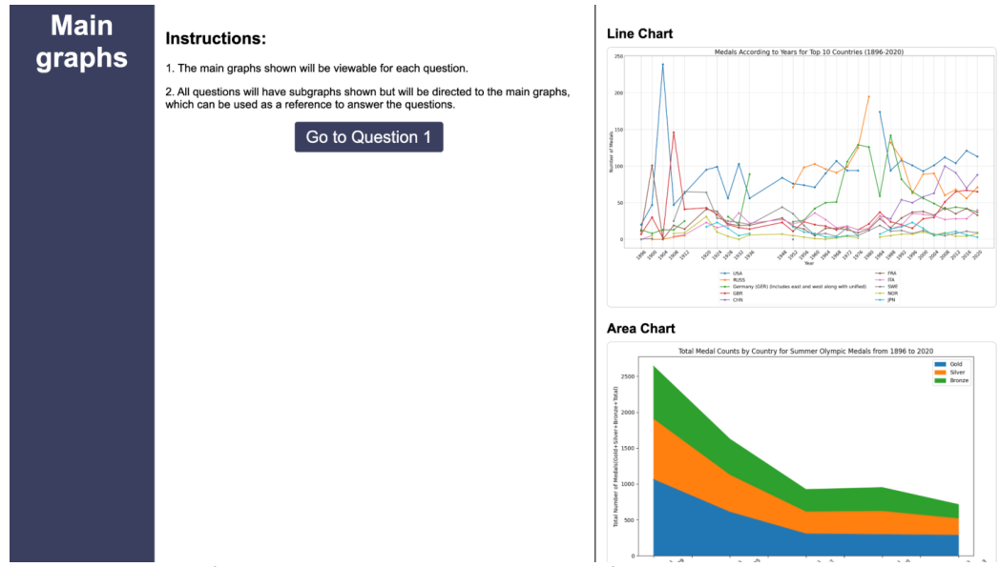
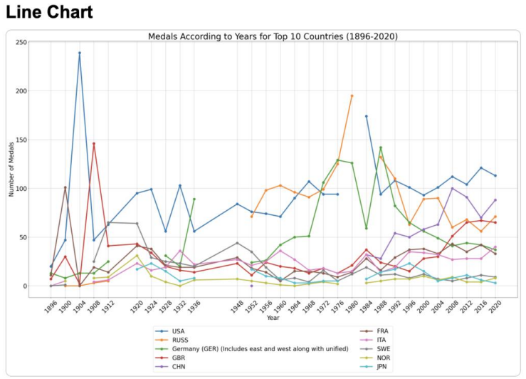
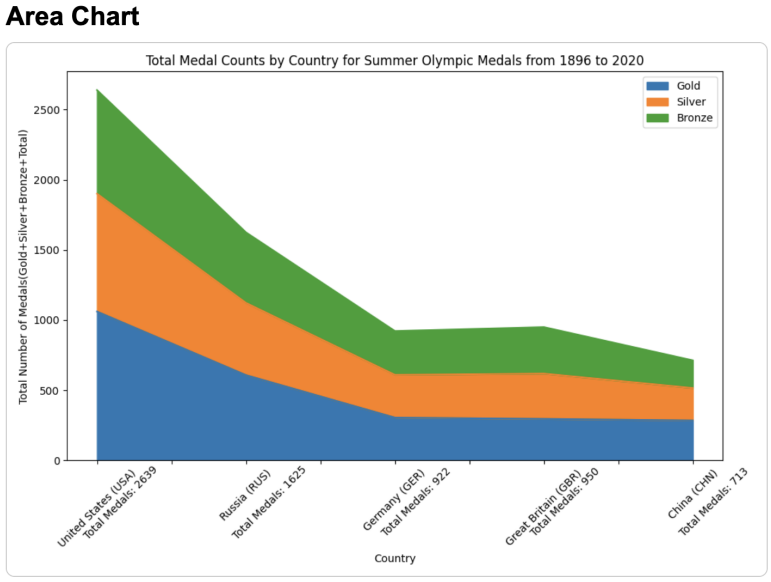
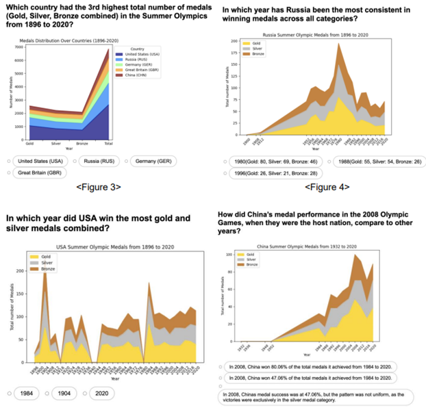

# Olympic Medal Analysis & Visualisation

An interactive Flask application for exploring historical Olympic medal trends and evaluating how people interpret different chart types.

The application presents **line and area visualisations of Olympic medal data from 1896–2020**, then guides participants through a randomised 20-question study while recording response time and accuracy.

<p align="center">
  
</p>

## Project overview

This coursework project investigates how effectively users understand historical medal data when it is presented through line charts and area charts. It combines data processing, server-generated visualisations, a browser-based questionnaire, and a small statistical analysis workflow.

### Key features

- **Interactive web questionnaire** built with Flask and Jinja templates
- **20 randomised questions** based on line and area charts
- **Dynamic chart generation** with Pandas and Matplotlib
- **Response-time and answer tracking** for each participant
- **Automatic scoring and results summary** at the end of the study
- **Statistical comparison** of response times using an independent-samples t-test

## Screenshots

### Main dashboard

Participants first see both primary visualisations together with the study instructions before moving into the timed questions.

<p align="center">
  
</p>

### Line-chart visualisation

The main line chart compares medal counts across the top ten countries over time.

<p align="center">
  
</p>

### Area-chart visualisation

The area chart compares gold, silver, and bronze medal totals across selected countries.

<p align="center">
  
</p>

### Timed questionnaire

Each question pairs a focused visualisation with multiple-choice answers and records the participant's response time.

<p align="center">
  
</p>

## How it works

1. Flask loads the Olympic medal datasets from the included Excel workbooks.
2. Pandas prepares the country and medal-series data.
3. Matplotlib generates the main charts and question-specific subplots in memory.
4. The application randomises the question order and displays each chart in the browser.
5. Participant answers and response times are collected for the final score summary.
6. `t-tests.py` provides a separate statistical comparison of mean response times.

## Technology stack

| Area | Technology |
|---|---|
| Web application | Python, Flask, Jinja2 |
| Data processing | Pandas, OpenPyXL |
| Visualisation | Matplotlib |
| Statistical analysis | SciPy |
| Front end | HTML, CSS, JavaScript |
| Data storage | Microsoft Excel workbooks |

## Getting started

### Prerequisites

- Python 3.9 or later
- `pip`

### Installation

```bash
git clone https://github.com/ml20g2l/Year3-Information-Visualisation.git
cd Year3-Information-Visualisation

python -m venv .venv
```

Activate the virtual environment:

```bash
# Windows PowerShell
.venv\Scripts\Activate.ps1

# macOS / Linux
source .venv/bin/activate
```

Install the required packages:

```bash
python -m pip install Flask pandas matplotlib openpyxl scipy
```

Run the application:

```bash
python app.py
```

Then open [http://127.0.0.1:5000](http://127.0.0.1:5000) in a browser.

> The Excel workbooks must remain in the repository root because the application loads them using relative paths.

## Repository structure

```text
.
├── app.py                              # Flask application and chart generation
├── templates/                          # Jinja HTML templates
│   ├── header.html
│   ├── index.html
│   ├── show_graph.html
│   └── testdone.html
├── docs/images/                        # Images displayed in this README
├── area chart and tests/               # Supporting data, questions, and experiments
├── line_chart.py                       # Standalone line-chart exploration
├── line_chart2.py                      # Additional line-chart exploration
├── t-tests.py                          # Response-time statistical analysis
├── *.xlsx                              # Olympic medal datasets
└── Information Visualisation Report.pdf
```

## Study design

- **Participants:** 10 volunteers
- **Questions:** 20 in total — 10 based on line charts and 10 based on area charts
- **Measures:** response accuracy and completion time
- **Analysis:** descriptive statistics and an independent-samples t-test comparing chart types
- **Ethics:** participants receive study information, provide informed consent, remain anonymous, and may withdraw at any time

## Project report

For the full methodology, design process, results, and team contribution breakdown, see the [Information Visualisation Report](./Information%20Visualisation%20Report.pdf).

## Team

- Ayesha Rahman
- Sandra Guran
- Natalie Leung
- Geeyoon Lim

Developed for **COMP3736 Information Visualisation** at the University of Leeds.
